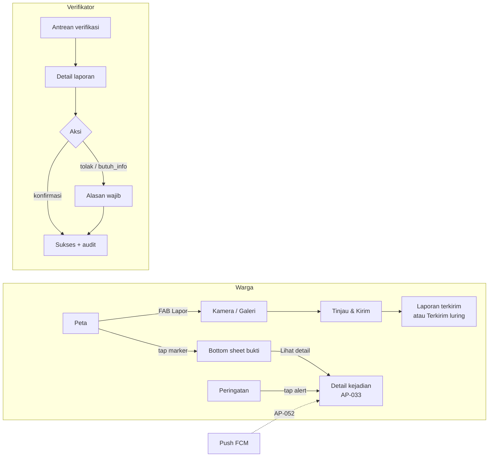

# 0005 — UX Flows & Design Tokens

| | |
|---|---|
| Status | Proposed |
| Author | QA — Anang |
| Task | `AP-008` |
| Created | 2026-11-07 |
| Reviewers | TL (approver), MOB-A, MOB-B, BE, WEB |

## Decisions for the Implementer (TL;DR)

- **D1 — The written spec wins over invention.** Source of truth for UI is
  `docs/PRD-ApiPantau.md` acceptance criteria → this log + `docs/ux/` → widget code. If a widget
  cannot meet a state in this log, record the deviation in `## Implementation Results`; do not
  silently redesign (`AGENTS.md:34`).
- **D2 — Four flows, fixed step budgets.** Report from the map is ≤ 3 user actions
  (FAB → shutter → Kirim); marker → incident sheet is 1 tap; alert → incident is 1 tap;
  a verifier decision is ≤ 2 taps plus a reason when the action is negative.
- **D3 — Status words come from the database, not from each screen.** `menunggu_verifikasi`,
  `terkonfirmasi`, `terkonfirmasi_ganda`, `ditolak`, `ditangani` and the incident values are
  mapped once in `docs/ux/copy-deck.md`. Raw snake_case never reaches the UI.
- **D4 — Tokens are semantic, light + dark, WCAG AA.** QA owns the values in
  `docs/ux/design-tokens.md`; TL/MOB-A own the Dart mapping in `apps/mobile/lib/core/theme/`.
  The provisional `AppTokens` (`apps/mobile/lib/core/theme/app_tokens.dart:5`) is replaced on
  approval. No new font package: the platform UI font is used.
- **D5 — One primary action per screen.** Destructive/negative verifier actions
  (`tolak`, `butuh_info`) always require a written reason. Status is never encoded by colour
  alone: icon + label + colour together.
- **D6 — Accessibility floor is non-negotiable.** Body text ≥ 14 sp, tap targets ≥ 48 dp,
  primary CTA 56 dp high, text contrast ≥ 4.5:1, UI/border contrast ≥ 3:1, dark mode,
  no text baked into images (`docs/PRD-ApiPantau.md:275`).
- **D7 — Offline is a state, not an error.** A queued report shows an optimistic confirmation
  with the PRD's label **"Terkirim (luring)"** plus the explanation that it will be sent when
  the connection returns (`docs/PRD-ApiPantau.md:141`). Retry only; no delete after submit (removing
  a photo before submit is allowed).
- **D8 — Alerts are contextual and honest.** Notification permission is requested with a
  rationale at the moment the user enables alerts or after the first report — never at app
  launch. Raw satellite hotspots never push to `warga`. The < 2 km safety alert cannot be
  disabled (`docs/PRD-ApiPantau.md:157`).
- **D9 — Verification is server-confirmed.** The queue is hidden for `warga`; actions go
  through `verify_report`, never an optimistic local status change. The audit trail is visible
  to verifier/admin (`design-log/0002-data-model-and-rls.md:20`, `docs/PRD-ApiPantau.md:164`).
- **D10 — Out of scope.** No Flutter/backend/SQL/admin code, no test code (`AP-027`), no
  accessibility audit (`AP-085`), no UAT script (`AP-088`), no auth UI (`DL-0006`), no final
  brand identity or product rename (TL decision, `docs/BACKLOG.md:264`).

## Background

`AP-008` is the M1 UX contract: flows for report, map, alerts, and verify plus design tokens
(`docs/BACKLOG.md:78`). The kickoff assigns QA to write it before the mobile seats build
(`docs/KICKOFF-M1.md:114`). The PRD fixes the acceptance criteria for the same four flows
(`docs/PRD-ApiPantau.md:126`–`:172`) but not screen order, state handling, copy, or visual
values.

DL-0002 fixed the data vocabulary and the server rules (`design-log/0002-data-model-and-rls.md:123`).
DL-0003 fixed routes, error mapping, and a deliberately provisional theme
(`design-log/0003-flutter-app-shell.md:28`, `:181`). Neither decides what a verifier sees when
the queue is empty, what "terkirim (luring)" looks like, or which colour means "aktif".

## Problem

Three seats will build six screens from the PRD in parallel. Without a shared flow and token
contract they will:

- invent different labels for the same status, so a report is "pending" on one screen and
  "menunggu" on another;
- request location and notification permission at launch without a rationale, losing the
  users the product depends on;
- render a queued report as an error, contradicting the offline-first promise;
- let a verifier action look successful before the RPC returns, producing silent audit gaps;
- hardcode colours and spacing, making dark mode and the M5 accessibility pass a rewrite.

The problem is solved when MOB-A and MOB-B can implement every state in this log without
asking a design question, and QA can walk the built app against the same checklist.

## Prior Art / Adjacent Mechanisms

| Mechanism | Where | Solves / constrains? |
|---|---|---|
| Report AC (3 steps, auto-location, 200 KB, optimistic, offline) | `docs/PRD-ApiPantau.md:133` | Fixed: step budget and offline label come from here |
| Map AC (layers, marker sheet, < 3 s, radius 2/5/10 km) | `docs/PRD-ApiPantau.md:143` | Fixed: sheet content and radius values |
| Alert AC (radius, content, 6 h dedupe, mandatory < 2 km) | `docs/PRD-ApiPantau.md:151` | Fixed: notification copy fields and preference rules |
| Verify AC (queue order, 3 actions, audit, double confirm) | `docs/PRD-ApiPantau.md:159` | Fixed: queue sort and action names |
| NFR: 48 dp, 14 sp, dark mode, contrast | `docs/PRD-ApiPantau.md:275` | Fixed: token floor (D6) |
| Report/incident state machines | `design-log/0002-data-model-and-rls.md:131` | Constrains labels and legal actions; no new states |
| `verify_report` RPC, audit rule | `design-log/0002-data-model-and-rls.md:146`, `:169` | Constrains verify flow: server-confirmed, reason in one call |
| Routes `/map`, `/report`, `/alerts`, `/verify`, `/incident/:id` | `design-log/0003-flutter-app-shell.md:181` | Reused; no new route names in AP-008 |
| Existing failure strings | `apps/mobile/lib/core/l10n/app_strings.dart:40` | Reused verbatim; no competing error copy |
| Provisional theme + 48 dp / 14 sp | `apps/mobile/lib/core/theme/app_tokens.dart:5`, `app_theme.dart:11` | Superseded by token values on approval (D4) |
| Router redirect (login → `/map`) | `apps/mobile/lib/core/router/app_router.dart:42` | **Constrains** alert deep links: `AP-052` must preserve the intended incident after login |
| Admin dashboard | `design-log/index.md:43` (DL-0004) | Out of scope; no admin screens here |
| `AP-027`, `AP-085`, `AP-088` | `docs/BACKLOG.md:97`, `:168`, `:171` | Downstream: test code, accessibility audit, UAT. This log supplies the states they assert |

**Null hypothesis:** could MOB-A/MOB-B design from the PRD plus Material defaults? No — the PRD
does not define the offline confirmation, the verifier conflict state, permission rationale,
or token values, and DL-0003 explicitly defers the final theme to this log
(`design-log/0003-flutter-app-shell.md:28`). Could we produce high-fidelity mockups instead?
No design tool or binary asset pipeline exists in the repo; a 2.5-day budget is better spent
on reviewable text specs, state matrices, and exact copy that survive in Git. This log closes
the UI contract and nothing product- or infrastructure-facing.

## Questions and Answers

**Q1 — How many taps is "≤ 3 steps" for a report, and do permission prompts count?**
A1 — Three app actions from the map: **Lapor** (FAB) → **shutter** (camera/gallery) → **Kirim
laporan** (review screen). System permission dialogs are OS UI and are not counted, but the
app's own rationale screen must not add a required fourth tap for users who already granted
permission. Compression and upload happen during the third action.

**Q2 — What happens when the user denies location?**
A2 — The report still works (`docs/PRD-ApiPantau.md:131`). The map opens at the national
extent with a persistent banner, and the review screen opens with a manual pin at the map
centre. The user can drag the pin and tap "Pakai lokasi ini". No dead end, no repeated modal.

**Q3 — What exactly is shown after Kirim when the device is offline?**
A3 — A confirmation sheet titled "Laporan tersimpan", chip **"Terkirim (luring)"**, body
"Laporan akan dikirim otomatis saat sinyal kembali." This keeps the PRD phrase while making
the queue state honest. It is not an error and has no red styling.

**Q4 — Can a report be edited or deleted after Kirim?**
A4 — No in MVP. Editing is allowed by RLS only while `menunggu_verifikasi` and only for note
and photos (`design-log/0002-data-model-and-rls.md:156`), but the UI does not expose it; that
would add a flow AP-008 does not budget. The confirmation offers "Lihat laporan saya"
(`AP-024`) and "Kembali ke peta". Delete is out of scope.

**Q5 — How are satellite hotspots distinguished from citizen reports on the map?**
A5 — Shape, icon, label, and colour together: hotspot = diamond/flame, report = circle/camera,
incident = area ring + status icon. The legend names all three and is reachable in one tap.
Colour alone is never the differentiator (D5).

**Q6 — What does a marker sheet show for each type?**
A6 — Common: source, relative time, status label, confidence label, distance from the user's
current/last point. Report adds a photo thumbnail and "Laporan warga". Hotspot adds satellite
and acquisition time. Incident adds incident status and a "Lihat detail" action (`AP-033`).
No technical IDs or raw coordinates in the primary reading order.

**Q7 — When is notification permission requested?**
A7 — Contextually: (a) when the user taps "Aktifkan peringatan" in the Alerts tab or profile,
or (b) immediately after the first successful report, whichever comes first. A pre-permission
rationale sheet explains radius, frequency, and that raw satellite data does not push to
warga. If denied, the Alerts tab still lists alerts; a banner offers "Buka Pengaturan".

**Q8 — Can the user turn off every alert?**
A8 — No. Per-type toggles are allowed, but the safety alert for an `aktif` incident within
2 km is always on and its switch is disabled with the explanation from the copy deck
(`docs/PRD-ApiPantau.md:157`). The radius selector offers 2/5/10 km only
(`docs/PRD-ApiPantau.md:149`).

**Q9 — Can a verifier work offline?**
A9 — No. Verification is a server transaction with an audit row; offline actions would be
unverifiable. The queue is readable from cache with an offline banner, but the three action
buttons are disabled and the reason is stated inline. No optimistic status change (D9).

**Q10 — What happens if two verifiers act on the same report?**
A10 — The second call fails the state-machine check. The UI shows "Laporan ini sudah
diproses" with the current status, removes the card from the queue, and offers "Muat ulang
antrean". The first action remains the only audit row.

**Q11 — What if camera permission is denied?**
A11 — Offer gallery first. If both camera and gallery are unavailable, submit is blocked with
"Laporan membutuhkan satu foto." and a "Buka Pengaturan" action. This is the only hard block
in the report flow; location has a manual fallback.

**Q12 — Do we need a separate incident detail route in AP-008?**
A12 — The sheet is the primary surface. `/incident/:id` already exists as a reserved route
(`apps/mobile/lib/core/router/app_router.dart:26`); the full detail screen and radius
preference belong to `AP-033`, and push deep-link handling belongs to `AP-052`. AP-008 defines
what the sheet and the destination must contain, not their implementation.

**Q13 — Why is the primary colour darker than the current seed?**
A13 — `#D84315` with white text is below 4.5:1 and fails the NFR. The token palette uses
`#B63A0E` on light (5.83:1 with white) and `#FFB59B` on dark (7.70:1 with `#5C1A00`). The
brand stays in the fire-orange family; only the value changes. Full ratios are in
`docs/ux/design-tokens.md`.

**Q14 — Does AP-008 decide typography packages or icon libraries?**
A14 — No. The platform UI font and the built-in Material icon set satisfy the specs and keep
the APK within budget (`docs/PRD-ApiPantau.md:271`). Adding a font or icon package is a TL
technical decision and is not required to meet this log.

## Design

### Overview



### Screen inventory

| ID | Screen | Route / surface | Implementing task | Flow doc |
|---|---|---|---|---|
| M1 | Peta + FAB | `/map` | `AP-009`, `AP-030` | `docs/ux/flows/02-map-incident.md` |
| M2 | Layer / legenda sheet | `/map` bottom sheet | `AP-030` | same |
| M3 | Marker sheet | `/map` bottom sheet | `AP-031` | same |
| M4 | Detail kejadian + radius | `/incident/:id` | `AP-033`, `AP-052` | same |
| R1 | Kamera / rationale | `/report` | `AP-020`, `AP-025` | `docs/ux/flows/01-report.md` |
| R2 | Tinjau & kirim | `/report` | `AP-020`, `AP-021` | same |
| R3 | Konfirmasi terkirim | sheet | `AP-020`, `AP-022` | same |
| A1 | Daftar peringatan | `/alerts` | `AP-052`, `AP-053` | `docs/ux/flows/03-alerts.md` |
| A2 | Preferensi peringatan | `/profile` section | `AP-053` | same |
| A3 | Push notification | system tray | `AP-052` | same |
| V1 | Antrean verifikasi | `/verify` | `AP-060` | `docs/ux/flows/04-verify.md` |
| V2 | Detail + aksi | `/verify/:id` (sheet) | `AP-060`, `AP-061` | same |

Navigation: bottom bar has **Peta**, **Peringatan**, **Verifikasi** (only for `verifikator` /
`admin`), **Profil**. The **Lapor** FAB appears only on Peta; it is the one main action
(`docs/PRD-ApiPantau.md:107`). Hiding Verifikasi is a UI guard, not a security boundary —
RLS/RPC remains the boundary (`design-log/0002-data-model-and-rls.md:151`).

### Status vocabulary

Single mapping used by map chips, list chips, sheets, and notifications. Full labels and
microcopy are in the **Status vocabulary** section of `docs/ux/copy-deck.md`.

| Report status | UI label | Tone token | Icon |
|---|---|---|---|
| `menunggu_verifikasi` | Menunggu verifikasi | neutral | `schedule` |
| `terkonfirmasi` | Terkonfirmasi | success | `check_circle` |
| `terkonfirmasi_ganda` | Terkonfirmasi ganda | successStrong | `verified` |
| `ditolak` | Ditolak | error | `cancel` |
| `ditangani` | Ditangani | info | `task_alt` |

| Incident status | UI label | Tone token | Icon |
|---|---|---|---|
| `terpantau` | Terpantau | warning | `visibility` |
| `aktif` | Aktif | error | `local_fire_department` |
| `terkendali` | Terkendali | info | `shield` |
| `selesai` | Selesai | neutral | `check_circle` |

Confidence: `rendah` → "Keyakinan rendah", `sedang`/`nominal` → "Keyakinan sedang",
`tinggi` → "Keyakinan tinggi", missing → "Keyakinan belum tersedia". Source: "Warga",
"Satelit", "Warga + satelit". Numeric AI scores are not shown in MVP.

### Design tokens (summary)

Full table, contrast ratios, component sizes, and dark-mode mapping: `docs/ux/design-tokens.md`.

| Group | Contract |
|---|---|
| Colour | Semantic roles: `surface`, `onSurface`, `primary`, `success`, `warning`, `error`, `info` + containers. Light/dark pairs, all AA. |
| Type | Compact scale (8 roles), minimum 14 sp; body 16/24; labels 14/20 semibold; line height ≥ 1.4 |
| Spacing | 4-based: 4, 8, 12, 16, 20, 24, 32, 40, 48, 64; screen margin 16; section gap 24 |
| Size | 48 dp minimum target; 56 dp primary CTA; 24 dp icon; 72 dp thumbnail |
| Radius | 8 / 12 / 16 / 20 (sheet top) / full (pill) |
| Motion | 120 ms micro, 200 ms enter, 300 ms sheet; honour reduced motion |

`AppTheme` currently derives everything from one seed (`apps/mobile/lib/core/theme/app_theme.dart:11`).
That is acceptable only until approval; the implementation must map the semantic tokens and
keep the existing failure strings (`apps/mobile/lib/core/l10n/app_strings.dart:40`).

### Interaction rules

1. One filled primary button per screen. Secondary actions are outlined/text; destructive
   actions are never the default focus.
2. Any action that changes a report or incident status requires a server response before the
   UI claims success. Disable the control and show a local progress state; prevent double tap.
3. Permission rationale precedes every OS prompt. Denial is recoverable from an in-app banner.
4. Lists and maps have explicit loading, empty, error, and offline states; a blank screen is a
   defect. Skeletons are preferred over a full-screen spinner for content that has shape.
5. Relative time ("12 menit lalu") for < 24 h, absolute time otherwise, Indonesian locale.
6. Distance uses "±" and one decimal: "±3,2 km"; below 1 km use metres: "±450 m".
7. Never show a raw UUID, coordinate pair, SQL status, HTTP code, or SDK exception; use the
   DL-0003 failure strings.
8. Snackbars last 4 s, carry at most one action, and never carry the only path to a critical
   task.

### State matrix

| Surface | Loading | Empty | Error | Offline | Permission denied |
|---|---|---|---|---|---|
| Peta | Skeleton + "Memuat peta…" | "Tidak ada kejadian di area ini." | DL-0003 error + "Coba lagi" | Cached tiles + "Peta luring" banner | Banner + "Aktifkan lokasi" |
| Laporan | "Menyiapkan foto…" | — | Reuse failure string; draft kept | Queue + "Terkirim (luring)" | Rationale / manual pin |
| Peringatan | Skeleton 3 rows | "Belum ada peringatan." | Error + retry | "Daftar mungkin belum terbaru." | Banner + "Buka Pengaturan" |
| Verifikasi | Skeleton cards | "Antrean bersih." | Error + retry | Actions disabled + reason | "Anda tidak punya akses." |

### Validation rules

| Field | Rule | Error / behaviour |
|---|---|---|
| Photo | Exactly 1 in MVP; JPEG/PNG; compressed ≤ 200 KB and ≤ 1280 px long edge before upload | Block submit: "Laporan membutuhkan satu foto." |
| Location | Required; GPS or manual pin inside Indonesia's extent | Block submit: "Tentukan lokasi laporan." |
| GPS accuracy | Warn when > 100 m | Inline warning, does not block |
| Note | Optional, ≤ 280 characters, suggestion chips append text | Counter appears at 240; submit disabled past 280 |
| Alert radius | One of 2 / 5 / 10 km | No free numeric input |
| Verify reason | Required for `tolak` and `butuh_info`, 10–280 characters | Inline error; RPC not called |
| Verify note | Optional for `konfirmasi`, ≤ 280 characters | — |
| Double submit | CTA disabled from tap until result | No duplicate row |
| Session expiry | Any 401 → "Sesi berakhir." + login | Draft/queue preserved |

### Cross-seat dependencies (not built by AP-008)

| Dependency | Owner / task | Why it matters here |
|---|---|---|
| Deep link after login keeps `/incident/:id` | `AP-052`, DL-0003 redirect | Current redirect lands on `/map` (`app_router.dart:54`); alert → incident must survive login |
| Compression + EXIF strip | `AP-021` | The "Menyiapkan foto…" state and ≤ 200 KB promise |
| Offline queue + retry | `AP-022` | "Terkirim (luring)" state and badge |
| Rate limit response mapping | `BE` (`AP-026`) | Copy for the 11th report/hour is defined here; the error code must be distinguishable |
| Radius + incident detail | `AP-033` | Destination of the marker sheet |
| Notification preferences | `AP-053` | Toggles, mandatory < 2 km switch |
| Verifier queue + action RPC | `AP-060`, `AP-061` | Queue sorting and `verify_report` result states |
| Role claim | `AP-010`, DL-0006 | Hiding the Verifikasi tab without trusting the client |
| Demo data | `AP-080` | Empty states must still look intentional during the demo |

## Implementation Plan

| Phase | Work | Owner | Done when |
|---|---|---|---|
| 0 | Review and approve this log; index `Planned → Proposed → Approved` | TL | Approval recorded before UI work starts |
| 1 | Write/refresh `docs/ux/` flow specs, tokens, copy, components | QA | Four flows + tokens reviewed; PR links resolve |
| 2 | Map tokens into `core/theme`; replace provisional seed; keep 14 sp/48 dp guards | TL / MOB-A | Light/dark build shows the token values; no hardcoded hex in widgets |
| 3 | Implement report flow against `01-report.md` | MOB-A (`AP-020`,`AP-021`,`AP-022`) | Every state in the flow doc is reachable |
| 4 | Implement map + marker sheet, alerts, verify against their flow docs | MOB-B (`AP-030`–`AP-033`, `AP-052`), MOB-A (`AP-060`, `AP-061`) | Flow checklists pass on device |
| 5 | QA walkthrough; file gaps as `AP-1xx`, append results | QA | No open UX defect without a task ID |

AP-008 itself delivers Phase 1 only. Phases 2–4 are existing backlog tasks and are listed to
show the handoff, not claimed by QA.

## Examples

✅ A status chip communicates without colour: icon + Indonesian label + tone background.

```
[schedule] Menunggu verifikasi      (neutral)
[check_circle] Terkonfirmasi        (success)
[verified] Terkonfirmasi ganda      (strong success)
```

✅ Offline result is honest and keeps the PRD phrase:

```
Laporan tersimpan
[Terkirim (luring)]
Laporan akan dikirim otomatis saat sinyal kembali.
[Lihat laporan saya]   [Kembali ke peta]
```

✅ Verifier negative action asks for a reason before calling the RPC:

```
Tolak laporan?
Alasan (wajib, 10–280 karakter)
[Batal]                         [Tolak laporan]
```

❌ A queued report styled as a failure:

```
[!] Gagal mengirim laporan. Periksa koneksi. [Coba lagi]
```

This contradicts the offline-first promise and invites duplicate reports.

❌ A notification permission dialog on first launch with no rationale, or a green dot alone
meaning "terkonfirmasi" — both fail US-01/US-03 and the accessibility floor.

❌ A verifier card that immediately turns green after tapping "Konfirmasi" while the RPC is
still in flight. If the call fails, the audit trail and the UI disagree.

## Trade-offs

| Option | Pros | Cons | Verdict |
|---|---|---|---|
| Text specs in `docs/ux/` + tokens | Reviewable in PR, versioned, grep-able, no binary assets | Less visual than mockups; relies on disciplined reading | **Chosen** |
| High-fidelity mockups/Figma | Visual fidelity | No tooling/asset pipeline, not reviewable in Git, 2.5 d budget | Rejected |
| One seed colour + Material defaults | Zero design work | Fails contrast, dark mode, and status semantics | Rejected |
| Semantic token set | Consistent, themeable, AA-checkable | Slightly more mapping work in `core/theme` | **Chosen** |
| Status by colour only | Fast to build | Fails accessibility; ambiguous on map tiles | Rejected |
| Icon + label + colour | Accessible and unambiguous | More horizontal space | **Chosen** |
| Optimistic verify status | Feels fast | Audit/UI divergence; server is the rulebook | Rejected |
| One photo only in MVP | 3-step promise, small payload | Multi-photo evidence deferred | **Chosen**; schema allows 3 |
| Contextual permission ask | Higher grant rate, honest | Requires a rationale surface | **Chosen** |
| Ask permissions at launch | One-time setup | High denial, no context, violates US-01 spirit | Rejected |

## Verification Criteria

- [ ] `docs/ux/` contains the four flow specs, token table, copy deck, and component contracts;
      every link in this log and in `docs/ux/README.md` resolves.
- [ ] Every PRD acceptance criterion for US-01…US-05 is mapped to a screen/state in the flow
      docs; no AC is left without a UI answer.
- [ ] Every report and incident status in DL-0002 has exactly one UI label and one tone token.
- [ ] Every colour pair used for text meets ≥ 4.5:1, every essential border/icon ≥ 3:1;
      ratios are recorded, not asserted.
- [ ] The four flows define loading, empty, error, offline, and permission-denied states;
      no state says "TBD".
- [ ] Token values and copy live outside widgets: on implementation, `rg "#[0-9A-Fa-f]{6}" apps/mobile/lib/features` returns nothing, and status strings appear only in the shared mapping.
- [ ] A reviewer can trace FAB → camera → Kirim in ≤ 3 actions and alert → incident in 1 tap
      from the docs alone.
- [ ] No Flutter/backend/SQL/admin file is added or modified by AP-008; QA paths only
      (`docs/ux/`, this log, index/backlog status).
- [ ] TL review recorded; DL status moves to `Approved` before Phase 2 starts.

## Implementation Results

_Append only after implementation starts. Do not edit the sections above._

### 2026-11-07 — AP-008 design deliverables

- Wrote DL-0005 and the QA-owned UX set under `docs/ux/`: four flow specs, design tokens,
  copy deck, component contracts, and an index/readme.
- No Flutter, backend, SQL, API, or database file was created or modified. Token values are a
  specification; the Dart mapping remains with TL/MOB-A in `apps/mobile/lib/core/theme/`.
- Mapped US-01…US-05 acceptance criteria to screens/states; recorded contrast ratios for every
  text/background pair used by the token set.
- Open dependency for `AP-052`: the current router redirect loses the intended incident after
  login (`apps/mobile/lib/core/router/app_router.dart:42`). Recorded, not fixed, because the
  router belongs to another seat.
- Next: TL review of this log; QA remains available for flow walkthroughs during M2/M3.
