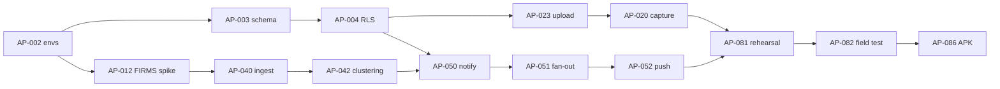

# ApiPantau — Product Backlog

Source of truth for **what** gets built, **by which seat**, and **when**.
Product intent lives in [`docs/PRD-ApiPantau.md`](PRD-ApiPantau.md); technical decisions live
in [`design-log/`](../design-log/index.md); roles and rituals live in
[`docs/TEAM.md`](TEAM.md).

| | |
|---|---|
| Plan window | 5 weeks (M1–M5), 6 seats |
| Planned P0 effort | ~89 ideal person-days |
| Capacity | ~120 usable person-days (see TEAM §Capacity) |
| Current milestone | M1 — Foundation |
| Last updated | 2026-11-07 |

## How to use this backlog

- **Task ID** `AP-NNN` is permanent and appears in branch names, commits, and PR titles.
- **Size**: `S` ≤ 1 day, `M` 2–3 days, `L` 4–5 days. Estimates are ideal days, not calendar.
- **Status**: `Todo → In Progress → Review → Done`. Move your own task; never move someone
  else's without telling them.
- **Design log (DL)**: required before code for `M`/`L` tasks and for any schema, RLS, auth,
  ingest, or notification change. A DL number that has no file yet is **reserved** — the
  owning seat must write it (from `design-log/template.md`) and mark it `Approved` before
  branching.
- **WIP limit**: one `In Progress` task and one `Review` PR per person.
- If a task is blocked > 4 hours, say so in the daily note and ping the dependency owner.

## Milestones

| Milestone | Theme | Exit condition |
|---|---|---|
| **M1** | Foundation | Apps build, CI green, schema + RLS live, auth works end-to-end |
| **M2** | Reports | A report can be created offline, synced, and seen in "Laporan saya" |
| **M3** | Alerts | FIRMS ingest creates incidents; a confirmed incident pushes to a device in radius |
| **M4** | Verify & Admin | Verifier queue works; dashboard shows real stats and exports CSV |
| **M5** | Harden & demo | Field test done, APK signed on 2 devices, end-to-end demo < 60 s |

## Week-by-week distribution

| Seat | M1 | M2 | M3 | M4 | M5 |
|---|---|---|---|---|---|
| **TL** | Repo/CI, backlog, DL-0001, unblock envs | Review DL-0002/0003, dependency control | Risk review, demo script draft | Release candidate cut, review | Field test lead, perf, pitch deck |
| **MOB-A** | Flutter shell, auth UI | Capture, compression, offline queue | Notification preferences | Verifier queue + audit | Perf fixes, bug triage |
| **MOB-B** | Map base, auth UI, FCM spike | My reports, location/manual pin | Map layers, marker panel, push deep link | Incident detail polish | Signed APK, device matrix |
| **BE** | Envs, schema, RLS, FIRMS spike | Upload, bbox queries, rate limit | FIRMS ingest, clustering, FCM fan-out | Double-confirm, seeder | Security/privacy review |
| **WEB** | Admin shell | Admin data model review, stats queries | — (help BE on RPC) | Dashboard, charts, CSV, audit viewer | Demo support, KPI screen |
| **QA** | UX flows, tokens, test strategy | Report test suite | Alert/ingest test plan | UAT script | Field test, accessibility, demo data |

## Epic summary

| Epic | Theme | Tasks | Ideal days | Milestone |
|---|---|---|---|---|
| E0 | Foundation | 12 | 18.5 | M1 |
| E1 | Reporting | 8 | 15.0 | M2 |
| E2 | Map & incidents | 4 | 7.5 | M2–M3 |
| E3 | Satellite ingest | 4 | 7.5 | M3 |
| E4 | Alerts | 5 | 9.0 | M3 |
| E5 | Verification | 4 | 7.0 | M4 |
| E6 | Admin dashboard | 6 | 9.5 | M3–M4 |
| E7 | Hardening & demo | 9 | 15.0 | M5 |
| E8 | Stretch (P1 only) | 6 | 15.0 | if time |
| **P0 total** | | **52** | **89.0** | |

---

## E0 — Foundation (M1)

| ID | Task | Owner | Size | Est | Depends on | DL | Status |
|---|---|---|---|---|---|---|---|
| AP-001 | Adopt design-log methodology, repo conventions, backlog, team charter | TL | S | 1 | — | 0001 | **Done** |
| AP-002 | Supabase projects (local/staging), env matrix, region `ap-southeast-1` | BE | S | 1 | AP-001 | — | Todo |
| AP-003 | PostGIS schema: `profiles`, `reports`, `hotspots`, `incidents`, `incident_evidence`, `verifications`, `notification_log` | BE | M | 2 | AP-002 | 0002 | Todo |
| AP-004 | RLS policies + role model (warga/verifikator/admin), audit triggers | BE | M | 1.5 | AP-003 | 0002 | Todo |
| AP-005 | Flutter shell: router, Riverpod, theme, flavors, error/result types | MOB-A | M | 2 | AP-001 | 0003 | Review |
| AP-006 | Admin shell: Vite + React + TS + Tailwind, Supabase client, query provider | WEB | S | 1.5 | AP-001 | 0004 | Todo |
| AP-007 | CI gates: format, analyze, test (mobile), tsc + eslint (admin), branch protection | TL | S | 1 | AP-005, AP-006 | 0001 | Todo |
| AP-008 | UX flows for report/map/alerts/verify + design tokens (color, type, spacing) | QA | M | 2.5 | AP-001 | 0005 | Review |
| AP-009 | Map base layer, OSM + Esri tiles, attribution, offline tile cache config | MOB-B | S | 1.5 | AP-005 | — | Todo |
| AP-010 | OTP auth end-to-end (phone + email fallback) with role claim | MOB-A / BE | M | 2.5 | AP-002, AP-005 | 0006 | Todo |
| AP-011 | FCM project, Android config, token registration spike | MOB-B | S | 1 | AP-005, AP-002 | — | Todo |
| AP-012 | NASA FIRMS MAP_KEY, probe API shape/limits, record sample payload | BE | S | 0.5 | AP-002 | — | Todo |

**M1 exit:** login on device → row in `profiles`; map renders with tiles; CI blocks a bad PR.

## E1 — Reporting (M2)

| ID | Task | Owner | Size | Est | Depends on | DL | Status |
|---|---|---|---|---|---|---|---|
| AP-020 | 1-tap report capture: camera/gallery, auto-location, movable pin, optional note | MOB-A | L | 3 | AP-005, AP-009, AP-008 | 0007 | Todo |
| AP-021 | Client image compression (≤ 1280 px, ~200 KB) + EXIF strip before upload | MOB-A | S | 1 | AP-020 | — | Todo |
| AP-022 | Offline queue with `drift`: local insert, retry/backoff, sync on reconnect, UI badge | MOB-A | L | 3 | AP-020, AP-003 | 0008 | Todo |
| AP-023 | Report upload + Storage bucket and object policies (`report-photos/{uid}/…`) | BE | M | 2 | AP-003, AP-004 | — | Todo |
| AP-024 | "Laporan saya" list with status chips and optimistic entries | MOB-B | S | 1.5 | AP-020 | — | Todo |
| AP-025 | Location permission with rationale + manual pin fallback | MOB-B | S | 1.5 | AP-009 | — | Todo |
| AP-026 | Server-side rate limit (10 reports/hour/user) + duplicate submit guard | BE | S | 1 | AP-023 | — | Todo |
| AP-027 | Widget + integration tests for capture and offline sync | QA | M | 2 | AP-020, AP-022 | — | Todo |

**M2 exit:** airplane mode → report → online → row + photo exist in Supabase, list shows "terkirim (luring)".

## E2 — Map & incidents (M2–M3)

| ID | Task | Owner | Size | Est | Depends on | DL | Status |
|---|---|---|---|---|---|---|---|
| AP-030 | Map layers: hotspots, reports, incidents; client cluster + bbox loading | MOB-B | L | 3 | AP-009, AP-032 | 0009 | Todo |
| AP-031 | Marker detail sheet: source, time, status, confidence, distance | MOB-B | S | 1.5 | AP-030 | — | Todo |
| AP-032 | `reports_in_bbox` / `hotspots_in_bbox` RPCs + indexes (GIST, created_at) | BE | S | 1.5 | AP-003 | — | Todo |
| AP-033 | Incident detail screen + alert radius preference (2/5/10 km) | MOB-B | S | 1.5 | AP-031 | — | Todo |

**E2 exit:** 500 seeded hotspots + 20 reports pan smoothly; tapping a marker shows confidence.

## E3 — Satellite ingest (M3)

| ID | Task | Owner | Size | Est | Depends on | DL | Status |
|---|---|---|---|---|---|---|---|
| AP-040 | `ingest-firms` Edge Function: fetch, normalize, dedup (`source+satellite+date+time+rounded lat/lon`), upsert | BE | L | 3 | AP-003, AP-012 | 0010 | Todo |
| AP-041 | Seasonal `pg_cron` schedule (30 min in May–Oct, 3 h otherwise) + manual trigger | BE | S | 1 | AP-040 | 0010 | Todo |
| AP-042 | Hotspot → incident clustering (`ST_ClusterDBSCAN`, eps 750 m, minpoints 2), incident lifecycle fields | BE | M | 2.5 | AP-040, AP-003 | 0010 | Todo |
| AP-043 | Ingest observability: run log, failure alert to admin, last-success badge | BE | S | 1 | AP-040 | — | Todo |

**E3 exit:** running the function twice does not duplicate hotspots; clusters appear as incidents.

## E4 — Alerts (M3)

| ID | Task | Owner | Size | Est | Depends on | DL | Status |
|---|---|---|---|---|---|---|---|
| AP-050 | `notify-incident` Edge Function: FCM HTTP v1, OAuth token, batched sends | BE | M | 2.5 | AP-011, AP-003 | 0011 | Todo |
| AP-051 | Radius fan-out (`ST_DWithin` on `home_geom`) + `notification_log` idempotency | BE | M | 2 | AP-050, AP-004 | 0011 | Todo |
| AP-052 | Push receive, foreground/background handling, deep link to incident on map | MOB-B | M | 2 | AP-011, AP-030 | — | Todo |
| AP-053 | Notification preferences: per-type toggles, radius, mandatory < 2 km warning | MOB-A | S | 1.5 | AP-010 | — | Todo |
| AP-054 | Anti-spam (1 per incident/6 h) + escalation re-notify rules | BE | S | 1 | AP-051 | — | Todo |

**E4 exit:** confirming an incident pushes to a device 4 km away, once, with a working deep link.

## E5 — Verification (M4)

| ID | Task | Owner | Size | Est | Depends on | DL | Status |
|---|---|---|---|---|---|---|---|
| AP-060 | Verifier queue sorted by time + distance to active incident | MOB-A | M | 2.5 | AP-010, AP-024, AP-033 | 0012 | Todo |
| AP-061 | Actions `konfirmasi`/`tolak`/`butuh_info` + `verifications` audit trail | MOB-A / BE | M | 2 | AP-060, AP-004 | 0012 | Todo |
| AP-062 | Double confirmation: report within 500 m of hotspot → `terkonfirmasi_ganda` | BE | S | 1.5 | AP-042, AP-061 | — | Todo |
| AP-063 | Verifier role assignment tooling (SQL view or admin action) | BE | S | 1 | AP-004 | — | Todo |

**E5 exit:** a verifier can clear the queue on a phone; every action is attributable.

## E6 — Admin dashboard (M3–M4)

| ID | Task | Owner | Size | Est | Depends on | DL | Status |
|---|---|---|---|---|---|---|---|
| AP-070 | `dashboard_stats` RPC: counts, median verification time, active incidents, reach estimate | WEB | M | 2 | AP-003, AP-004 | — | Todo |
| AP-071 | Admin UI: KPI cards, region + date filters, loading/empty/error states | WEB | M | 2.5 | AP-006, AP-070 | 0004 | Todo |
| AP-072 | Weekly trend chart (Recharts) for reports vs confirmed | WEB | S | 1.5 | AP-071 | — | Todo |
| AP-073 | CSV export respecting active filters | WEB | S | 1 | AP-071 | — | Todo |
| AP-074 | Admin auth guard: role check, session expiry, no service-role key in client | WEB | S | 1 | AP-006, AP-010 | 0004 | Todo |
| AP-075 | Audit log viewer (verifications + notification log) | WEB | S | 1.5 | AP-061 | — | Todo |

**E6 exit:** a judge-facing screen shows real numbers, filterable and exportable.

## E7 — Hardening & demo (M5)

| ID | Task | Owner | Size | Est | Depends on | DL | Status |
|---|---|---|---|---|---|---|---|
| AP-080 | Demo data seeder: 1 village, 60 reports, 300 hotspots, 3 incidents, 2 verifiers | BE | S | 1.5 | AP-003 | — | Todo |
| AP-081 | End-to-end rehearsal: report → verify → push → map, scripted, timed | QA | S | 1.5 | E1–E5 | — | Todo |
| AP-082 | Field test in 1 RT/village; triage findings | All | L | 3 | AP-081 | — | Todo |
| AP-083 | Performance pass: API p95 < 500 ms, map < 3 s, APK ≤ 40 MB | TL / MOB-A / BE | M | 2 | — | — | Todo |
| AP-084 | Security & privacy review: RLS audit, EXIF, location exposure, PDP note | BE / TL | S | 1.5 | AP-004 | — | Todo |
| AP-085 | Accessibility: contrast, 48 dp targets, 14 sp text, dark mode | QA | S | 1.5 | AP-008 | — | Todo |
| AP-086 | Signed APK, install on 2 physical devices, upgrade path test | MOB-B | S | 1 | AP-083 | — | Todo |
| AP-087 | Pitch deck + impact data (detection time saved, reach, KPI deltas) | TL | M | 2 | AP-082 | — | Todo |
| AP-088 | UAT script + bug bash; log defects as `AP-1xx` tasks | QA | S | 1 | AP-081 | — | Todo |

**M5 exit (DoD MVP):** all US-01..US-06 acceptance criteria pass manual test; APK on 2 devices;
demo runs < 60 s without a crash.

## E8 — Stretch (P1/P2, only after P0 is green)

Do not start these until M4 exit is confirmed. No owner assigned until then.

| ID | Task | Candidate owner | Size | Est | PRD ref |
|---|---|---|---|---|---|
| AP-090 | On-device + cloud AI photo classification | MOB-B + BE | L | 5 | F-11 |
| AP-091 | AQI / haze panel for user location | WEB | S | 2 | F-13 |
| AP-092 | Daily risk index from weather (rain, humidity, wind) | BE | M | 3 | F-12 |
| AP-093 | Incident auto-grouping tuning + merge/split | BE | S | 1.5 | F-14 |
| AP-094 | Contribution points / simple profile stats | MOB-A | S | 2 | F-15 |
| AP-095 | Quota saver mode (on-demand satellite tiles, aggressive compression) | MOB-B | S | 1.5 | F-16 |
| AP-096 | WhatsApp reporting bot | — | L | 8 | F-17 (P2) |
| AP-097 | SIPONGI/ANTARES integration (needs MoU) | — | L | 10 | F-18 (P2) |

---

## Role load and rebalancing

Load = assigned P0 ideal days, excluding ceremony time.

| Seat | Load (d) | Capacity (d) | State | Action |
|---|---|---|---|---|
| TL | 5.5 | 22.5 | Under | Absorbs review/coordination (~5 d); owns risk and release |
| MOB-A | 16.0 | 22.5 | Healthy | Takes AP-090/AP-094 if P0 stays green |
| MOB-B | 14.5 | 22.5 | Healthy | Takes AP-095 or AI support |
| **BE** | **29.25** | **22.5** | **Over (~130%)** | See rebalance moves below |
| WEB | 11.0 | 22.5 | Under | Takes AP-063 tooling + AP-080 seeder; then AP-091 |
| QA | 8.5 (+3 shared field test) | 22.5 | Under | Add per-epic test plans; design + field-test prep |

### BE rebalance moves (decide at M1 planning, before branch cut)

| # | Move | Frees |
|---|---|---|
| 1 | AP-063 verifier tooling → WEB (small admin screen over role column) | 1.0 |
| 2 | AP-080 demo seeder → WEB (SQL + CSV import) | 1.5 |
| 3 | Merge AP-043 into AP-040 acceptance criteria (same function log) | 1.0 |
| 4 | Merge AP-026 into AP-051 (SQL guard + unique index) | 1.0 |
| 5 | Merge AP-041 into AP-040 (cron config ships with function) | 1.0 |
| 6 | AP-084 split with TL (0.75 each) | 0.75 |
| | **Result** | **BE ≈ 23.0 d** |

If BE still slips, descope in this order (announce at Friday demo):
1. AP-054 anti-spam → keep basic dedupe only
2. AP-062 double confirmation → manual flag by verifier
3. AP-075 audit viewer → Supabase Studio for the demo
4. AP-072 trend chart → KPI cards only
5. All of E8

## Critical path

Anything on this path wins over scheduled work. If a critical-path task is blocked for half a
day, the TL reassigns a second person to it.

## Dependencies on external parties

| Dependency | Needed by | Owner | Fallback if late |
|---|---|---|---|
| Supabase project + billing | M1 day 1 | BE | Local Supabase only; staging later |
| NASA FIRMS `MAP_KEY` (free registration) | M1 day 3 | BE | Manual CSV import from FIRMS |
| FCM project + `google-services.json` | M1 day 4 | MOB-B | In-app local notification for demo |
| SMS/OTP provider or test numbers | M1 day 4 | BE | Email OTP + fixed test OTP |
| Test devices (2 Android, Android 8+) | M2 | QA | Emulator for dev, borrow for demo |
| Pilot RT/village contact | M4 | TL | Simulated field test with team members |

## Open decisions

| # | Decision | Owner | Needed by | Default if undecided |
|---|---|---|---|---|
| O1 | Final product name (PRD §17.3) | TL | M5 pitch freeze | `ApiPantau` |
| O2 | Who verifies during demo (PRD §17.2) | TL | M4 | QA + TL act as verifiers |
| O3 | Pilot partnership 1 village (PRD §17.4) | TL | M4 | Internal field test |
| O4 | iOS build in scope? (PRD §17.1) | TL | M2 | Android only, iOS compiles |
| O5 | Open-source the repo? (PRD §17.5) | TL | M5 | Keep private, MIT license file present |
| O6 | SMS provider budget | BE | M1 day 4 | Email OTP + test numbers |

## Definition of Ready / Done

**Ready** (before a task moves to `In Progress`): acceptance criteria known, owner assigned,
dependencies merged, design log approved if required, demo/verification method clear.

**Done**: see `AGENTS.md` → Definition of Done. In short: AC met, tests pass, analyze/lint
clean, design log results appended, index updated, cross-seat review approved.

## Changelog

| Date | Change | By |
|---|---|---|
| 2026-10-31 | Initial backlog: 52 P0 tasks across 8 epics, 6 seats, M1–M5 distribution | TL |
| 2026-11-07 | AP-008: DL-0005 + `docs/ux/` deliverables written (4 flows, tokens, copy, components); AP-008 → Review | QA |
