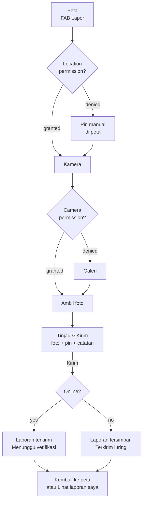

# Flow 01 — Lapor (Report)

| | |
|---|---|
| Task | `AP-008` |
| Flow owner (UX) | QA |
| Implemented by | MOB-A — `AP-020`, `AP-021`, `AP-022`, `AP-025` |
| PRD source | US-02 `docs/PRD-ApiPantau.md:133`; US-01 location clause `:130` |
| Design log | DL-0005 |
| Status | Proposed |

## Goal

A citizen who sees smoke or fire can submit a photo report from the map in **three actions**,
without needing signal, and can tell whether the report is sent or waiting.

| Metric | Target | Source |
|---|---|---|
| Actions from map to submitted report | ≤ 3 | `docs/PRD-ApiPantau.md:136` |
| Photo before upload | ≤ 200 KB, long edge ≤ 1280 px | `docs/PRD-ApiPantau.md:139` |
| Optimistic confirmation | immediate after Kirim | `docs/PRD-ApiPantau.md:140` |
| Offline reports eventually delivered | ≥ 90% | `docs/PRD-ApiPantau.md:78` |

## Entry and exit

- **Entry:** FAB **Lapor** on `/map` (R0). No other required entry in MVP.
- **Exit (online):** confirmation sheet → **Kembali ke peta** or **Lihat laporan saya**.
- **Exit (offline):** confirmation sheet with **Terkirim (luring)** → same choices.
- **Cancel:** back arrow on R2 opens "Buang laporan?" with **Lanjut mengisi** / **Buang**. A
  draft is never discarded silently.

## Flow



## Step budget (US-02)

| # | Action | Screen | Notes |
|---|---|---|---|
| 1 | Tap **Lapor** | R0 Peta | One main action, always visible on the map |
| 2 | Tap shutter (or gallery) | R1 Kamera | System camera UI; permission rationale precedes it once |
| 3 | Tap **Kirim laporan** | R2 Tinjau & kirim | Location, note, and compression are not extra actions |

The app's own rationale screens do **not** appear again after the permission is granted. A user
who already granted permissions reaches R2 in 3 actions.

## Screens

### R0 — Peta, entry point

- FAB: 56 dp, extended with icon + label **Lapor**, bottom-right, 16 dp from edges and above
  the bottom navigation and safe area.
- If offline at entry, a persistent banner appears above the navigation: **Anda sedang luring**
  + "Laporan tetap bisa dibuat dan akan dikirim otomatis." The FAB stays enabled.
- If location is denied, the map still opens (national extent) with a dismissible banner
  **Aktifkan lokasi**; the report flow uses a manual pin.
- The FAB is not shown on Verifikasi/Profil to avoid accidental reports.

### R1 — Camera / photo

**R1a — Location rationale (first report only, if permission not yet decided)**

- Bottom sheet, title **Izinkan lokasi?**
- Body explains the benefit and the privacy rule: the report point is public, the home point is
  not. Exact copy: `C-101a`–`C-101d` in `copy-deck.md`.
- Actions: **Izinkan lokasi** (filled) / **Pilih lokasi manual** (text).
- OS permission prompt only after **Izinkan lokasi**.
- If denied at OS level: no loop. Move to R2 with the manual pin and the inline hint **Geser
  pin ke titik asap/api.**

**R1b — Camera permission rationale (first capture only)**

- Title **Izinkan kamera?**, body `C-102a`–`C-102d`.
- **Izinkan kamera** → OS prompt → camera. **Pilih dari galeri** is always available.
- If camera permission is denied permanently: gallery remains; if gallery also fails, R2 blocks
  submit with **Laporan membutuhkan satu foto.** and **Buka Pengaturan**.

**R1c — Capture**

- Prefer the system camera (`image_picker`) in photo mode, rear camera, flash auto.
- Full-bleed preview, 4:3 guide frame, shutter 72 dp, gallery shortcut 48 dp, close 48 dp.
- After capture: R2. No separate "use photo?" step — that would be a fourth action.
- One photo in MVP. Retake/replace happens on R2. Multi-photo is deferred; the schema allows up
  to 3 (`design-log/0002-data-model-and-rls.md:124`).

### R2 — Tinjau & kirim

Single scrollable screen; primary CTA is pinned above the keyboard/safe area.

**Anatomy, top to bottom**

1. App bar: back, title **Tinjau laporan**.
2. Photo preview 4:3, 16 dp radius. Overlay actions: **Ganti foto**, **Hapus** (both 48 dp
   targets). Replacing returns to R1.
3. Map snippet, 160 dp high, with a draggable pin and a **Lokasi saya** button (48 dp).
   - Address/label: **Titik laporan** + coordinates hidden behind a "Lihat koordinat" disclosure.
   - Accuracy warning when > 100 m: **Akurasi lokasi rendah (±120 m). Geser pin bila perlu.**
   - When GPS is unavailable: **Lokasi belum tersedia. Geser pin ke titik asap/api.**
4. Note field: label **Catatan (opsional)**, hint `C-129`, multiline 3–4 lines, counter at 240/280.
   - Suggestion chips above the field: **Asap tebal**, **Sudah ada api**, **Bau terbakar**.
     Tapping appends the phrase to the note; tapping again does not duplicate it.
5. Submit area: **Kirim laporan** filled, 56 dp, full width. While preparing/uploading it becomes
   a progress button with **Mengirim…** and is disabled.
6. Inline privacy note: **Lokasi laporan akan terlihat publik; lokasi rumah Anda tidak.**

**Behaviour**

- Location is required. With GPS it is filled automatically; the user may drag the pin. With no
  permission it starts at the map centre and must be confirmed by dragging (or "Lokasi saya"
  if permission becomes available).
- Photo is required in MVP.
- Tapping Kirim:
  1. freeze the form and disable the CTA;
  2. show **Menyiapkan foto…** while compressing/stripping EXIF (`AP-021`);
  3. if online: submit, then R3 online;
  4. if offline or the request fails with a network error: enqueue locally (`AP-022`), then R3
     offline. Keep the draft until the queue owns it.
  5. if the server rejects the content (validation/permission): stay on R2, keep every field,
     show the DL-0003 failure string, re-enable the CTA.
- Rate limit (10 reports/hour/user, `docs/PRD-ApiPantau.md:273`): stay on R2 with **Terlalu
  banyak laporan. Coba lagi dalam {menit} menit.** The server's retry value is used; the UI does
  not invent a timer. Dependency: BE must make this state distinguishable (`AP-026`).
- Double tap cannot create two reports: the CTA is disabled until a result exists.

### R3 — Result sheet

**Online — success**

```
Laporan terkirim
[schedule] Menunggu verifikasi
Verifikator akan memeriksa laporan Anda.
[Lihat laporan saya]        [Kembali ke peta]
```

- Shown as a bottom sheet over the map, not a blocking full screen.
- Status is server-confirmed `menunggu_verifikasi` (`design-log/0002-data-model-and-rls.md:136`).
- If the server returns but the photo upload is still finishing, the sheet still shows
  **Laporan terkirim**; the user is never shown a partial technical state. Retry happens in the
  background; a permanent photo failure is surfaced in "Laporan saya" (`AP-024`), not here.

**Offline — queued**

```
Laporan tersimpan
[cloud_off] Terkirim (luring)
Laporan akan dikirim otomatis saat sinyal kembali.
[Lihat laporan saya]        [Kembali ke peta]
```

- Uses the PRD phrase **"Terkirim (luring)"** (`docs/PRD-ApiPantau.md:141`) and the cloud-off
  icon; tone is neutral/info, never error/red.
- No "Coba lagi" here: retry is automatic. Manual retry lives in the queue/list surface.
- If the app is closed and reopened, the queued item must still be visible in "Laporan saya";
  the user is not asked to re-create it.

## States

| State | Trigger | UI | Allowed actions |
|---|---|---|---|
| Location loading | GPS fix in progress | Pin skeleton + **Mencari lokasi…** | Drag pin, choose manually |
| Location denied | OS denial | Inline hint + manual pin | Drag, submit |
| Low accuracy | accuracy > 100 m | Amber inline warning | Drag, submit |
| Camera denied | OS denial | Gallery CTA + settings link | Gallery, settings |
| Compressing | after Kirim | **Menyiapkan foto…**, CTA disabled | None (brief) |
| Uploading | online submit | **Mengirim…**, CTA disabled | None |
| Offline | no connectivity | Queue + R3 offline | View list, back to map |
| Network error | timeout/socket | Stay on R2, failure string, CTA enabled | Retry |
| Validation error | server 4xx | Stay on R2, fields kept | Fix, retry |
| Rate limited | 429/limit | Stay on R2 + retry window | Back, retry later |
| Session expired | 401 | **Sesi berakhir.** + login | Login; draft preserved |
| Photo failure (permanent) | storage/policy error | Stay on R2 + **Foto gagal diunggah. Coba lagi.** | Retry, replace photo |

## Validation

| Field | Rule | Message |
|---|---|---|
| Photo | 1 required; compressed before upload | `C-121` |
| Location | Required, inside Indonesia's extent | `C-122` |
| Note | ≤ 280 chars | Counter; CTA disabled past limit |
| Radius (not in this flow) | 2/5/10 km only | See flow 02 |
| Submit | Disabled while in flight | — |

## Copy

All strings are defined in [`copy-deck.md`](../copy-deck.md): `C-100`–`C-129`. Do not paraphrase in
widgets. Reuse DL-0003 failure strings
(`apps/mobile/lib/core/l10n/app_strings.dart:40`) instead of new error text.

## Acceptance criteria mapping

| PRD AC | Where satisfied |
|---|---|
| ≤ 3 steps from main screen | R0 → R1 → R2 (step table above) |
| GPS auto-location, movable pin | R2 map snippet + **Pakai lokasi ini** / drag |
| Note optional with suggestions | R2 note field + 3 chips |
| Compression ≤ 200 KB / 1280 px | R2 **Menyiapkan foto…** + `AP-021` |
| Optimistic "Laporan terkirim", status `menunggu_verifikasi` | R3 online |
| Offline queue, auto-send, "terkirim (luring)" | R3 offline + `AP-022` |
| Location denial still allows reporting | R0/R2 manual pin |
| Location rationale, not a blind prompt | R1a |

## Dependencies / out of scope

- `AP-021` compression + EXIF strip; `AP-022` queue/retry/backoff; `AP-023` storage; `AP-026`
  rate limit; `AP-020` capture; `AP-025` location rationale implementation.
- "Laporan saya" list is `AP-024`; this flow only defines the status chips it must use.
- No edit/delete after submit in MVP.
- No multi-photo, no video, no AI classification.

## QA walkthrough checklist

- [ ] From the map, a report is submitted in exactly 3 app actions.
- [ ] Denying location still produces a report with a manual pin.
- [ ] Denying camera still allows gallery; denying both blocks with a clear explanation.
- [ ] Airplane mode → submit → **Terkirim (luring)** (not an error) → online → item sends once.
- [ ] Double-tapping Kirim creates one report.
- [ ] 281-character note cannot be submitted; suggestion chips append without duplicates.
- [ ] Every failure keeps the draft and offers a valid next action.
- [ ] All text ≥ 14 sp, all targets ≥ 48 dp, dark mode legible.
