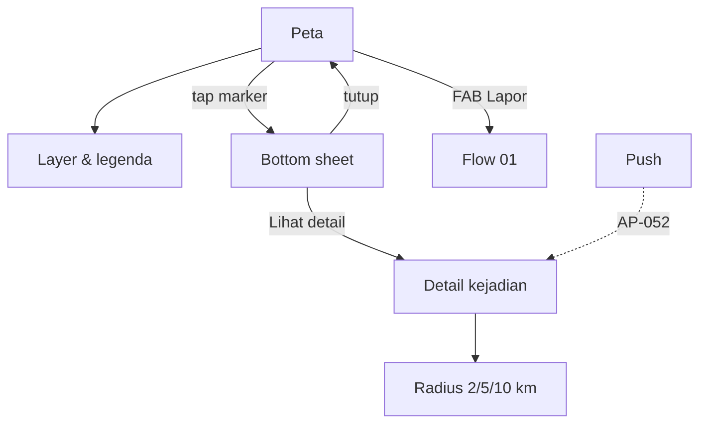

# Flow 02 — Peta & Kejadian (Map + Incident)

| | |
|---|---|
| Task | `AP-008` |
| Flow owner (UX) | QA |
| Implemented by | MOB-B — `AP-009`, `AP-030`, `AP-031`, `AP-033` |
| PRD source | US-03 `docs/PRD-ApiPantau.md:143`; US-04 radius `:149` |
| Design log | DL-0005 |
| Status | Proposed |

## Goal

A citizen opens the map and understands, within seconds, whether there is smoke/fire near
home, what the source is, and how much to trust it. A verifier or admin can see the same
evidence without a different vocabulary.

| Metric | Target | Source |
|---|---|---|
| Map visible on 4G with base tiles cached | < 3 s | `docs/PRD-ApiPantau.md:148` |
| Marker → summary understanding | 1 tap | `docs/PRD-ApiPantau.md:147` |
| Alert radius choices | 2 / 5 / 10 km | `docs/PRD-ApiPantau.md:149` |
| Layers present | hotspots, reports, incidents | `docs/PRD-ApiPantau.md:146` |

## Entry and exit

- **Entry:** app start after login → `/map`; bottom navigation **Peta**; push deep link
  (`/incident/:id`, `AP-052`).
- **Exit:** marker sheet → **Lihat detail** → incident detail; sheet → **Lapor**? No — the FAB
  is the only report entry.
- **Return:** back closes the sheet/detail and restores the previous camera position and zoom.

## Flow

## Screens

### M1 — Peta

**Layout**

- Full-screen map. Top app bar is transparent over the map with a surface scrim for legibility:
  title **Peta**, subtitle (optional) **Kejadian di sekitar Anda**.
- Top-right stack of 48 dp controls: **Layers** (layers icon), **Lokasi saya** (crosshair).
  Bottom-left: **Legenda** (48 dp).
- Bottom navigation: Peta, Peringatan, Verifikasi (role-gated), Profil.
- FAB **Lapor** bottom-right, 56 dp, above navigation.
- Attribution bottom, above navigation, 14 sp, on a translucent surface for contrast:
  "© OpenStreetMap contributors" and "Esri World Imagery" when the satellite layer is on.
  Not dismissible (licence requirement).

**Camera**

- First open with location permission: centre on the user at zoom 12.
- Permission denied: restore the last camera position; if none, show Indonesia at zoom 4.5
  with a banner **Aktifkan lokasi untuk melihat kejadian di sekitar Anda.**
- Returning from a sheet/detail restores the exact camera.
- Deep link to an incident centres on it at zoom 14 and opens the sheet.

**Layers (M2)**

Bottom sheet **Layer peta** with three switches and a legend:

| Layer | Default | Marker encoding | Empty note |
|---|---|---|---|
| **Kejadian** (incidents) | On | Area ring + status icon; fill 16% opacity | "Belum ada kejadian di area ini." |
| **Titik panas satelit** (7 days) | On | Diamond, flame icon | "Tidak ada titik panas dalam 7 hari." |
| **Laporan warga** | On | Circle, camera icon | "Belum ada laporan warga." |

- Switch rows are 48 dp high; labels are full sentences, not codes.
- Legend is always reachable; it repeats shape + icon + label, so the map does not rely on
  colour (`docs/PRD-ApiPantau.md:275`).
- Layer preferences persist for the session; persistence across restarts is nice-to-have.
- Toggling a layer does not reset camera or selection.

**Marker hierarchy**

| Element | Shape | Size | Icon | Colour token |
|---|---|---|---|---|
| Incident `aktif` | Area + centroid dot | Ring 2 px, dot 20 dp | `local_fire_department` | error |
| Incident `terpantau` | Area + centroid dot | Ring 2 px, dot 20 dp | `visibility` | warning |
| Incident `terkendali` | Area + centroid dot | Ring 2 px, dot 20 dp | `shield` | info |
| Incident `selesai` | Area + centroid dot | Ring 2 px, dot 16 dp | `check_circle` | neutral |
| Satellite hotspot | Diamond | 12–16 dp | `local_fire_department` | `#F59E0B`, dark outline |
| Citizen report | Circle with white photo glyph | 20 dp (cluster number when grouped) | `photo_camera` | `#1A5CA8` |
| User location | Dot + accuracy halo | 16 dp + 24 dp halo | — | info |

- Every marker gets a 2 dp surface halo so it stays visible on light and dark tiles.
- Clustering is visual only; tapping a cluster zooms in until individual markers appear.
- Selected marker grows to 28 dp and gets a 2 dp focus ring (accessibility).
- No marker colour is the only signal: shape + icon + label in the sheet.

### M3 — Marker sheet

Bottom sheet, drag handle, opens at 45% height, expands to 85%. Common reading order:

1. **Type + source** — e.g. **Laporan warga**, **Titik panas satelit**, **Kejadian**.
2. **Status chip** — `terkonfirmasi`, `aktif`, etc. using the fixed mapping (`copy-deck.md`).
3. **Time** — "12 menit lalu" / "7 Nov 2026, 14.05".
4. **Confidence** — icon + **Keyakinan tinggi/sedang/rendah**; missing → **Keyakinan belum
   tersedia**.
5. **Distance** — "±3,2 km dari lokasi Anda" or hidden when location is unknown.
6. Type-specific block (below).
7. Primary action and close.

| Type | Extra content | Actions |
|---|---|---|
| **Report** | Photo thumbnail 72 dp, note excerpt (2 lines), reporter display name (never phone number; `docs/PRD-ApiPantau.md:274`) | **Lihat detail** (if linked to an incident), **Tutup** |
| **Hotspot** | Satellite product + acquisition time, confidence from FIRMS | **Tutup** |
| **Incident** | Incident summary, evidence count ("2 laporan, 3 titik panas"), radius ring | **Lihat detail** (filled), **Tutup** |

- No raw UUID, latitude/longitude, SQL status, or confidence number in the primary reading
  order. Coordinates may appear behind a "Lihat koordinat" disclosure on the detail screen.
- The sheet does not open a second sheet on top; selecting another marker replaces the content.
- While data loads: skeleton lines inside the sheet, not a spinner over the map.

### M4 — Detail kejadian (AP-033)

- Header: status chip + title **Kejadian** + relative time.
- Summary: what is burning (asap/api), source mix, confidence.
- Mini-map with the incident area and the user's point.
- Evidence: counts by type; a list of linked reports (thumbnail + status) and hotspots
  (time + confidence). Empty evidence is impossible for a real incident but must render a
  neutral state.
- **Radius peringatan** section: segmented control **2 km / 5 km / 10 km**, default 5 km.
  - Selection saves immediately; snackbar **Radius peringatan disimpan: 5 km.**
  - Explanatory text: **Peringatan dikirim saat kejadian terkonfirmasi di dalam radius ini.**
  - The < 2 km safety rule is always on and is not a selectable value here; it is explained in
    notification preferences (`flow 03`).
- If the incident is `selesai`, the radius control is disabled with **Kejadian ini sudah
  selesai.**
- Actions: **Lihat di peta** (centres M1) and back.

## States

| State | UI | Notes |
|---|---|---|
| Loading first map | Map surface skeleton + **Memuat peta…** | No full-screen blocking spinner |
| Loading markers | Subtle top progress bar; previous markers stay if cached | Avoid flicker on pan |
| Empty viewport | Inline card **Tidak ada kejadian di area ini.** + **Perluas peta** | Not an error |
| Network error | DL-0003 failure + **Coba lagi**; cached markers remain | `app_strings.dart:40` |
| Offline | Banner **Peta luring — data mungkin belum terbaru.** + last-updated time | Cached tiles and last data |
| Location denied | Banner + **Aktifkan lokasi** | Map still usable |
| GPS unavailable | "Lokasi belum tersedia" chip; distance hidden | No wrong distance |
| Marker data stale | Relative last-update label in layer sheet | — |
| Deep link invalid ID | **Kejadian tidak ditemukan** + back to map | Validate UUID before fetch |
| Radius save fails | Revert selection + failure string + retry | No optimistic setting |

## Performance & interaction rules

- Cached base tiles render first; markers stream in. The map is interactive before all markers
  arrive.
- Pan/zoom triggers a debounced bbox query; no request per frame.
- Marker tap is acknowledged visually within 100 ms even if the sheet content is still loading.
- Sheet drag and map gestures must not fight: dragging the sheet does not move the map.
- Do not block the map with a modal on first open; the location rationale is a sheet that can be
  dismissed.

## Acceptance criteria mapping

| PRD AC | Where satisfied |
|---|---|
| Layers: hotspots, reports, incidents | M2 layer sheet + encoding table |
| Marker sheet: source, time, status, confidence | M3 reading order |
| Map < 3 s on 4G with cache | Loading/performance rules; `AP-009` |
| Alert radius 2/5/10 km | M4 segmented control |
| Location permission rationale | M1 banner + `flow 01` R1a |
| Deep link to incident | M4 entry via `/incident/:id`; `AP-052` dependency |

## Dependencies / out of scope

- Tiles, attribution, cache: `AP-009`.
- bbox/cluster queries: `AP-030`, `AP-032`.
- Incident detail and radius persistence: `AP-033`; preference storage follows `AP-053`.
- Push deep link: `AP-052`. Current login redirect loses the target
  (`apps/mobile/lib/core/router/app_router.dart:42`); flagged in DL-0005.
- No drawing tools, no user-added map pins (other than the report pin), no routing.
- No public web map (`docs/PRD-ApiPantau.md:100`).

## QA walkthrough checklist

- [ ] All three layers toggle independently and the legend matches the markers.
- [ ] Tapping each marker type opens the correct sheet with source, time, status, confidence,
      and distance (or hides distance when unknown).
- [ ] Denying location leaves the map usable and never shows a false distance.
- [ ] Airplane mode shows cached tiles with the offline banner; returning online refreshes.
- [ ] Map is interactive < 3 s on a mid-range Android device on 4G with cache.
- [ ] Radius 2/5/10 saves and survives reopening the detail screen.
- [ ] No raw status, UUID, or coordinates in the primary sheet text.
- [ ] Marker selection is visible in dark mode and on satellite imagery.
