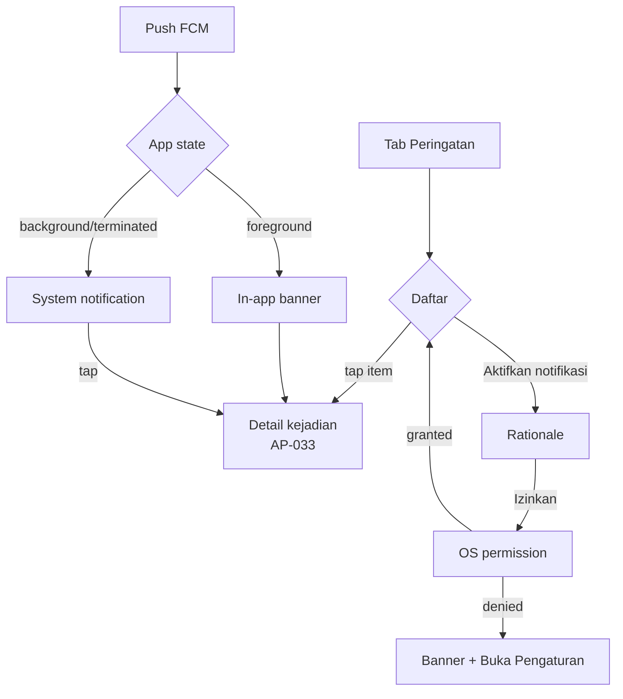

# Flow 03 — Peringatan (Alerts & Push)

| | |
|---|---|
| Task | `AP-008` |
| Flow owner (UX) | QA |
| Implemented by | MOB-B — `AP-052`, `AP-053`; BE — `AP-050`, `AP-051`, `AP-054` |
| PRD source | US-04 `docs/PRD-ApiPantau.md:151`; notification rules `:232` |
| Design log | DL-0005; fan-out contract DL-0011 (planned) |
| Status | Proposed |

## Goal

A citizen receives one trustworthy alert when a confirmed incident is near home, understands
why it arrived and how far away it is, and can open the incident in one tap. The alert layer
never becomes noise: raw satellite hotspots do not push to citizens.

| Rule | Contract | Source |
|---|---|---|
| Trigger | Incident status `terkonfirmasi` / `aktif` inside the user's radius | `docs/PRD-ApiPantau.md:154` |
| Default radius | 5 km | `docs/PRD-ApiPantau.md:236` |
| Choices | 2 / 5 / 10 km | `docs/PRD-ApiPantau.md:149` |
| Duplicate suppression | None for the same incident within 6 h, except escalation | `docs/PRD-ApiPantau.md:156` |
| Mandatory safety alert | `aktif` within 2 km cannot be disabled | `docs/PRD-ApiPantau.md:157` |
| Raw hotspot push to `warga` | Never | `docs/PRD-ApiPantau.md:239` |

## Entry and exit

- **Entry:** bottom navigation **Peringatan**; push notification tap; in-app foreground banner.
- **Exit:** alert item → `/incident/:id` (map + detail); back returns to the list.
- **Badge:** unread alert count on the tab, capped at **9+**; cleared when the incident is
  opened or all items are read.

## Flow



## Screens

### A1 — Daftar peringatan

**Layout**

- App bar **Peringatan**, action **Preferensi** (gear, 48 dp).
- If permission is missing/denied: a dismissible banner at the top, `C-305` / `C-306`.
- List grouped by day: **Hari ini**, **Kemarin**, then date headings. Sorted newest first.
- Item card (min height 88 dp, 16 dp padding):
  - Leading status icon in a tone container.
  - Title: type + distance — **Api terkonfirmasi ±3,2 km**.
  - Body: area label + relative time — **Sukamaju · 12 menit lalu**.
  - Trailing: unread dot (8 dp) + chevron.
  - Status chip for the incident (`aktif`, `terkendali`, `selesai`).
  - Source label when present: **Warga + satelit**.
- Items are not colour-coded by severity alone; icon + title + status chip.
- Pull-to-refresh; skeleton 3 cards on first load.
- Tapping an item marks it read locally and opens the incident. If the incident data fails to
  load, show **Kejadian tidak ditemukan** with a back action.

**Empty state**

```
[notifications_none]
Belum ada peringatan
Peringatan muncul saat ada kejadian terkonfirmasi di radius Anda.
[Atur radius]
```

**Offline**

- Show cached list with banner **Anda sedang luring. Daftar mungkin belum terbaru.**
- Push that arrived while offline is still listed when the app opens; details require network.
- No destructive actions here.

**Loading / error**

- Loading: skeletons, not a centred spinner.
- Error: DL-0003 failure string + **Coba lagi**; cached items stay visible.

### A2 — Preferensi peringatan (AP-053)

Reached from A1 or Profil. Sections:

**1. Izin notifikasi**

- Status row: **Notifikasi: Aktif** / **Notifikasi: Dimatikan**.
- If off: **Aktifkan notifikasi** (filled) + helper `C-303`; if permanently denied,
  **Buka Pengaturan**.
- Rationale sheet before the OS prompt: `C-301a`–`C-301d`.

**2. Radius**

- Segmented control **2 km / 5 km / 10 km**, default 5.
- Helper: **Peringatan dikirim saat kejadian terkonfirmasi di dalam radius ini.**
- Saving is immediate; snackbar **Radius peringatan disimpan: 5 km.**
- A radius change does not re-send old alerts.

**3. Jenis peringatan**

| Row | Warga | Verifikator/Admin | Default |
|---|---|---|---|
| **Kejadian baru di radius** | On, toggleable | On, toggleable | On |
| **Eskalasi kejadian** | On, toggleable | On, toggleable | On |
| **Laporan baru di sekitar** | Hidden | On, toggleable | On for verifier |
| **Titik panas satelit baru** | Hidden (never pushed) | On, toggleable | Off |
| **Peringatan keselamatan < 2 km** | **On, disabled** | On, disabled | Locked |

- The locked row uses a disabled switch plus helper `C-304`: safety alert for an `aktif`
  incident within 2 km cannot be turned off.
- Rows are 48 dp high; the whole row toggles, not just the switch.
- Saving a preference is server-backed; on failure revert and show the DL-0003 string.
- No "save" button; explicit snackbar or inline confirmation.

### A3 — Push notification

**Payload contract (consumer side)**

| Field | Rule | Example |
|---|---|---|
| Title | ≤ 40 chars, no emoji, leads with **Peringatan** or **Api** | **Peringatan: api terkonfirmasi ±3,2 km** |
| Body | ≤ 120 chars: what, where, when, source | **Asap tebal di Sukamaju. 12 menit lalu. Sumber: warga + satelit.** |
| Deep link | `/incident/{uuid}` | `/incident/8f3…` |
| Incident ID | UUID validated before routing | — |
| Channel | **Peringatan ApiPantau**, high importance, default sound | One channel; do not create per-incident channels |

Copy variants are in `copy-deck.md` `C-310`–`C-319`. The backend composes the strings; the app
only renders what it receives and must not crash on missing optional fields.

**Foreground behaviour**

- Show an in-app top banner, not a system notification (avoids duplicate).
- Banner: icon + title + body (2 lines) + **Lihat**; auto-dismiss after 8 s; swipe to dismiss.
- If the user is already viewing the same incident, do not show the banner; update the sheet.
- Tapping **Lihat** opens the incident; if the session expired, login is required first.

**Background / terminated**

- System notification with the app icon and the same title/body.
- Tap opens the app and routes to `/incident/:id`.
- **Dependency:** the current redirect sends a signed-in user to `/map` and a signed-out user
  to `/login`, losing the target (`apps/mobile/lib/core/router/app_router.dart:42`). `AP-052`
  must preserve the intended incident through login; until then this AC is at risk.

**Duplicates and escalation**

- The user never sees a duplicate for the same incident within 6 h. Suppression is silent.
- An escalation may notify once more; the title/body must say it changed:
  **Peringatan diperbarui: api semakin luas**.
- If several incidents are near, each is a separate notification; do not merge in MVP.
- Do not notify for `terpantau` or raw hotspots to `warga`.

## States

| State | UI | Behaviour |
|---|---|---|
| Permission not asked | Banner **Aktifkan peringatan** | Tapping opens rationale |
| Permission denied | Banner + **Buka Pengaturan** | List still works; no push |
| Permission granted | No banner | — |
| No alerts | Empty state above | **Atur radius** opens A2 |
| Loading | Skeleton cards | — |
| Error | Failure string + retry | Cached list stays |
| Offline | Offline banner | List from cache |
| Incident missing | **Kejadian tidak ditemukan** | Back to list |
| Push with bad/missing ID | Ignore payload; log client-side (no crash) | Do not open a random screen |
| Session expired on tap | **Sesi berakhir.** + login | Deep link preserved (`AP-052`) |

## Acceptance criteria mapping

| PRD AC | Where satisfied |
|---|---|
| Notify when confirmed incident is within preference radius | A3 trigger contract + A2 radius |
| Content: type, distance, time, source, "Lihat di peta" | A3 payload table + copy deck |
| No duplicate within 6 h except escalation | A3 duplicates + BE `AP-054` |
| Per-type toggles; < 2 km active always on | A2 toggles + locked row |
| Raw hotspot not pushed to citizens | A2 hidden row + trigger contract |
| Deep link to incident | A3 foreground/background + `AP-052` |

## Dependencies / out of scope

- FCM setup/token: `AP-011`; fan-out and idempotency: `AP-050`, `AP-051`, `AP-054`, DL-0011.
- Notification preferences persistence: `AP-053`.
- Deep link routing: `AP-052` (blocking risk noted above).
- No rich media, action buttons, or custom sounds in MVP.
- No digest/quiet hours; anti-spam is server-side and invisible.
- No alerts for P1 weather/AQI features.

## QA walkthrough checklist

- [ ] Fresh install: no notification prompt at launch; rationale appears only from A1/A2 or
      after the first successful report.
- [ ] Denying permission leaves the list usable and offers **Buka Pengaturan**.
- [ ] Confirmed incident 4 km away → exactly one push; title/body match the contract.
- [ ] Same incident again within 6 h → no second push; escalation → one updated push.
- [ ] Raw hotspot → no push for a `warga` account.
- [ ] Toggle off a type → no push of that type; toggle back on → pushes resume.
- [ ] Locked < 2 km row cannot be disabled; helper text is visible.
- [ ] Tap push from terminated state → incident detail, not the map root.
- [ ] Foreground push → in-app banner only, no duplicate system notification.
- [ ] All alert copy is Indonesian and contains no raw status/technical field.
