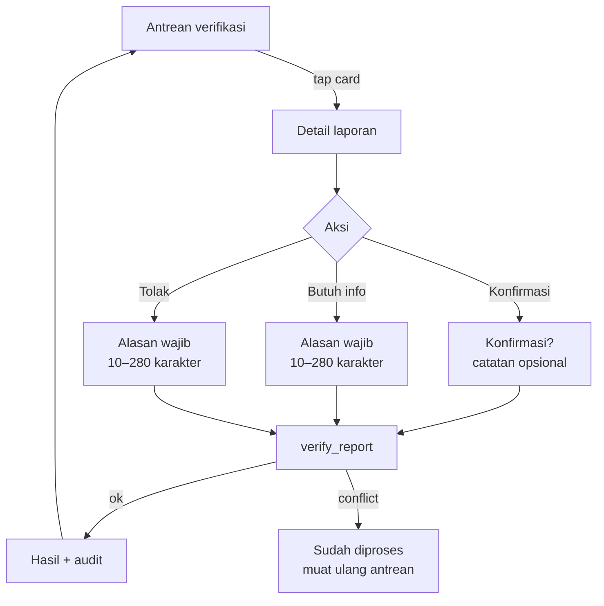

# Flow 04 — Verifikasi (Verifier Queue)

| | |
|---|---|
| Task | `AP-008` |
| Flow owner (UX) | QA |
| Implemented by | MOB-A — `AP-060`, `AP-061`; BE — `AP-062` |
| PRD source | US-05 `docs/PRD-ApiPantau.md:159`; state machine `:218` |
| Design log | DL-0005; queue/audit contract DL-0012 (planned) |
| Status | Proposed |

## Goal

A community verifier clears a queue of citizen reports quickly and defensibly. Every decision
is attributable, negative decisions carry a reason, and the verifier can see the evidence that
makes a report credible — without leaving the phone.

| Rule | Contract | Source |
|---|---|---|
| Queue order | Distance to active incident, then age; unlinked reports after linked | `docs/PRD-ApiPantau.md:161` |
| Actions | `konfirmasi`, `tolak`, `butuh_info` | `docs/PRD-ApiPantau.md:162` |
| Audit | Who, when, decision, note | `docs/PRD-ApiPantau.md:164` |
| Double confirmation | Within 500 m of a hotspot → `terkonfirmasi_ganda` | `docs/PRD-ApiPantau.md:165` |
| Access | `verifikator` / `admin` only | `design-log/0002-data-model-and-rls.md:151` |

## Entry, role gate, exit

- **Entry:** bottom navigation **Verifikasi** (visible only for `verifikator`/`admin`), or a
  queue notification for verifier/admin (`flow 03`).
- **Role gate:** for `warga` the tab is hidden. A direct route still renders
  **Anda tidak punya akses.** with **Kembali ke peta**. Hiding is UI, not security; RLS/RPC is
  the boundary (`design-log/0002-data-model-and-rls.md:169`).
- **Exit:** after a decision, the next card in the queue is shown; back returns to the list at
  the same scroll position.

## Flow



## Screens

### V1 — Antrean verifikasi

**Layout**

- App bar: **Verifikasi**, count badge **Verifikasi (7)**, info action explaining the sort
  (**Diurutkan: jarak ke kejadian aktif, lalu waktu**), refresh.
- Filters are out of scope for MVP; the queue is intentionally one list.
- Card (min height 104 dp, 16 dp padding, 12 dp gap):
  - Leading photo thumbnail 72 dp, 8 dp radius. Missing photo → neutral placeholder with
    caption **Tanpa foto**.
  - Line 1: **Laporan warga** + status chip **Menunggu verifikasi**.
  - Line 2: relative time + waiting age — **12 menit lalu · menunggu 12 menit**.
  - Line 3: distance to nearest active incident — **±850 m dari kejadian aktif**; if none,
    **Tidak terkait kejadian aktif**.
  - Line 4 (optional): note excerpt, 1 line, ellipsis.
  - Trailing chevron.
- `butuh_info` reports stay in the queue; the card shows an info chip **Butuh info terkirim**
  and the previous request as the excerpt. Age continues from the original submission; the
request never resets urgency.
- New items while viewing: a top pill **3 laporan baru · Muat ulang** instead of silently
  reordering the list under the verifier's finger.

**Empty state**

```
[task_alt]
Antrean bersih
Tidak ada laporan yang menunggu verifikasi.
[Muat ulang]
```

**Sorting contract (visible in the info sheet)**

1. Reports linked to an active/`terpantau` incident: ascending distance to that incident.
2. Reports not linked to an incident: after linked reports, newest first.
3. Ties: oldest `created_at` first.
4. `ditolak` and `ditangani` never appear.

### V2 — Detail laporan

Pushed page within `/verify`; not a new top-level route.

**Anatomy**

1. App bar: back, **Verifikasi laporan**, overflow **Lihat riwayat**.
2. Photo: full width, 4:3, pinch-to-zoom; page indicator if more than one (MVP sends one).
   Placeholder if missing.
3. Status chip + **Menunggu verifikasi** + waiting age.
4. Note (full text, selectable). If empty: **Tidak ada catatan.**
5. Location block: 160 dp mini-map with report pin and, when present, nearest hotspot ring
   (500 m) + active incident centroid. Caption:
   **±420 m dari titik panas terdekat** / **Tidak ada titik panas dalam 500 m**.
   Address label; coordinates behind **Lihat koordinat**.
6. Evidence block:
   - **Laporan ini** — source `warga`, created time, reporter display name (never phone number).
   - **Titik panas terdekat** — distance, acquisition time, confidence.
   - **Kejadian terkait** — incident status + distance, tap to open detail (read-only context).
7. Audit block: last actions from `verifications` — actor display name, action label, time, note.
   Immutable list, newest first. Empty: **Belum ada tindakan.**
8. Sticky bottom action bar (safe area + 16 dp):
   - **Konfirmasi** — filled, 56 dp, primary.
   - **Butuh info** — outlined, 48 dp.
   - **Tolak** — text button, destructive tone, 48 dp.
   - Actions are disabled while offline or while a request is in flight.

**Action dialogs**

| Action | Dialog | Requirement |
|---|---|---|
| `konfirmasi` | **Konfirmasi laporan?** Body: "Laporan akan berstatus terkonfirmasi dan dapat memicu peringatan radius." Note **Catatan (opsional)** | Note ≤ 280 |
| `butuh_info` | **Minta informasi tambahan** Field **Apa yang perlu dilengkapi?** | 10–280 chars |
| `tolak` | **Tolak laporan?** Field **Alasan penolakan** | 10–280 chars |

- Confirm button label repeats the action: **Konfirmasi laporan**, **Kirim permintaan**,
  **Tolak laporan**. Never "OK".
- Cancel is always available and returns focus to the action bar.
- Keyboard opens automatically for the reason fields; CTA disabled until valid.
- No optimistic status. The card stays on **Menunggu verifikasi** with a progress state until
  the RPC returns.

**Results**

- `konfirmasi` → success sheet: **Laporan terkonfirmasi** + **Laporan berikutnya** /
  **Kembali ke antrean**.
  - If the server upgraded to `terkonfirmasi_ganda`: **Terkonfirmasi ganda** +
    **Peringatan radius dikirim.**
- `butuh_info` → **Permintaan terkirim** + "Pelapor akan melihat permintaan ini." The report
  remains in the queue.
- `tolak` → **Laporan ditolak** + "Alasan tercatat di audit." Removed from the queue.
- Conflict (already processed by another verifier) → **Laporan ini sudah diproses** + current
  status; remove from queue; **Muat ulang antrean**.
- Network failure → stay on the dialog/detail with the DL-0003 string and **Coba lagi**; the
  decision is not recorded twice.

**Audit trail**

- Every action writes `verifications` with actor, action, note, timestamp
  (`design-log/0002-data-model-and-rls.md:128`).
- The verifier can read the history; it cannot edit or delete it.
- The reporter-facing surface (`AP-024`) shows `butuh_info` as a call to add information; the
  exact wording is in `copy-deck.md` `C-420a`–`C-420c`.

## States

| State | UI | Allowed actions |
|---|---|---|
| Loading queue | 3 skeleton cards | — |
| Empty queue | "Antrean bersih" | Refresh |
| Loading detail | Skeleton blocks; actions disabled | Back |
| Error | DL-0003 string + retry | Retry |
| Offline | Banner **Verifikasi membutuhkan koneksi.**; actions disabled | Read cached detail |
| Role denied | **Anda tidak punya akses.** | Back to map |
| In-flight | Action buttons disabled + progress | None |
| Conflict | "Sudah diproses" + current status | Reload queue |
| Missing report | **Laporan tidak ditemukan.** | Back to queue |
| Photo unavailable | Placeholder + **Foto tidak tersedia** | Decide with note if evidence is enough |

## Validation

| Field | Rule | Behaviour |
|---|---|---|
| Reason (`tolak`, `butuh_info`) | 10–280 chars after trim | Inline error `C-412`; CTA disabled |
| Note (`konfirmasi`) | ≤ 280 chars | Counter at 240 |
| Action | Exactly one of the three; server enforces transitions | Invalid transition → conflict state |
| Double submit | Disabled until result | One audit row |

## Acceptance criteria mapping

| PRD AC | Where satisfied |
|---|---|
| Queue ordered by time and distance to active incident | V1 sort contract + info sheet |
| Actions `konfirmasi` / `tolak` / `butuh_info` | V2 action bar + dialogs |
| Audit trail: who, when, decision, note | Audit block + `verifications` |
| Double confirmation < 500 m → `terkonfirmasi_ganda`, alert triggered | Result state + BE `AP-062` |
| Role-restricted access | Tab hidden for warga; route guard; RLS boundary |

## Dependencies / out of scope

- Queue query/sort and role claim: `AP-060`, `AP-010`.
- RPC and audit: `AP-061`, DL-0012; `verify_report` is the only write path
  (`design-log/0002-data-model-and-rls.md:146`).
- Double confirmation: `AP-062` (server-side; the verifier does not choose it).
- Reporter-facing "butuh info" surface: `AP-024`.
- Push to verifier for a new report: `AP-051`/`AP-054` rules in `flow 03`.
- No bulk actions, no assignment, no chat with the reporter, no offline verification, no undo.

## QA walkthrough checklist

- [ ] Warga cannot see the tab; a direct route shows the permission message, not the queue.
- [ ] Queue cards show photo, age, distance, status; ordering matches the stated rule.
- [ ] Confirming a report within 500 m of a hotspot results in `terkonfirmasi_ganda` and the
      success copy says the radius alert was sent.
- [ ] `tolak` and `butuh_info` cannot be submitted with fewer than 10 characters.
- [ ] A second verifier acting on the same report gets the conflict state, and only one audit
      row exists.
- [ ] Offline queue is readable but actions are disabled with the reason shown.
- [ ] Every decision appears in the audit block with actor, time, action, and note.
- [ ] No optimistic status change before the RPC returns.
